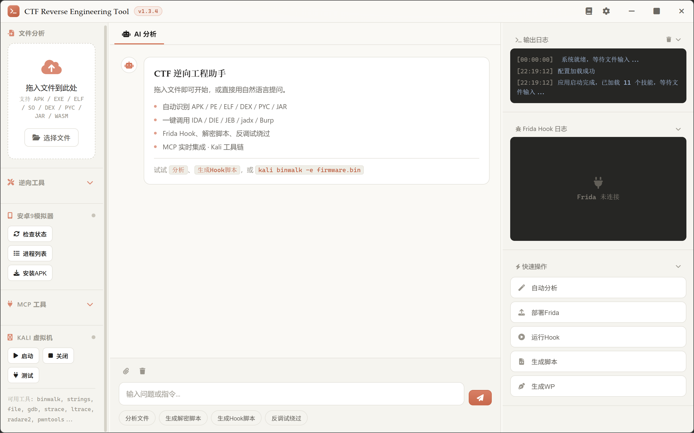

# CTF-RE-TOOL v1.3.11

[](https://github.com/ip2867/ctf-re-tool/releases)
[](LICENSE)
[]()
[]()

一个基于 Electron 的 **CTF 逆向 AI 解题工作台**（Windows 桌面应用）。把「静态分析 → 动态 Hook → 算法还原 → 本地验证」串成一条 AI 可自主驱动的流水线，并通过 MCP 实时接入 **IDA / JEB / Burp**，内置 **11 个逆向方法论技能**（Skills）与**可检索的结构化知识库**（Wiki）。

核心是**解题成功率**，不是功能堆砌：

- **AI 工具循环（Tool-Use）**：AI 自主调用 JEB/IDA/Frida/Python 等工具反复推进，而不是一次性问答；分阶段提示词（①收集 → ②定位算法 → ③写脚本本地验证 → ④结论）。
- **本地验证闭环**：AI 给出的每个 flag 都附 `[VERIFY]` 契约，工具自动生成 Python 复现脚本本地跑一遍，标注 ✅已验证 / ⚠️未验证——**不靠"AI 说解出来了"就当解出来了**。
- **结构化知识库**：54 页可检索手法/题解页（含 43 篇历年逆向题，带 `attack_chain` 解法链 / `reasoning_chain` 思维链 / `failed_attempts` 避坑），按关键词结构化加权检索，命中即注入 AI 上下文。
- **经验自进化**：每次解题沉淀的多步攻击链写入经验库，下次同类题自动速查复用。

**下载**：到 [Releases](https://github.com/ip2867/ctf-re-tool/releases) 下载 `CTF-RE-TOOL.exe`（便携单文件，双击即用）。

> 适用范围：CTF 竞赛、授权渗透测试、自有系统的安全研究。请勿用于未授权目标。

## 功能特性



> 三栏布局：左侧文件分析与工具区，中间 AI 对话，右侧输出日志 / Frida Hook / 快速操作。

### 1. 文件拖入+自动识别
- 支持 APK、EXE/PE（含 .NET 识别）、ELF/SO、DEX、PYC（全版本魔数）、JAR/.class、Lua 字节码、WASM、Mach-O
- ZIP 按内容精确区分 APK / JAR / 普通 ZIP
- .NET 程序集自动提示 dnSpy/ilspycmd 流程；APK 自动检测 Unity IL2CPP（global-metadata.dat）
- 显示文件详细信息（MD5、SHA256、大小等）

### 2. 一键调用逆向工具
**静态分析工具：**
- IDA Pro - 静态分析
- DIE - 查壳工具
- JEB - Android 分析
- jadx - DEX→Java 反编译

**脱壳工具：**
- UPX - 脱壳工具
- apktool - APK 解包

**Python工具：**
- pycdc - Python 字节码反编译
- pycdas - Python 字节码反汇编

### 3. Frida 自动 Hook
- 自动生成**针对题目情报**的 Hook 脚本（从静态分析提取类名/native 方法/算法特征注入模板，而非固定模板）
- **Java 层**：Cipher、MessageDigest、String、SharedPreferences、Base64、`Arrays.equals` 等
- **Native 层**：主动扫描 Java 声明的 native 方法 + **RegisterNatives 拦截**（动态注册、无 `Java_` 导出时的唯一入口）+ 符号级 `findFunc`
- **JCE 通杀自吐**：Hook `Cipher.init`/`doFinal`，不追业务代码直接吐算法/密钥/明文
- **进程内解密出 flag**：把已求得的 key/iv/密文注入 Hook，在 App 进程内直接 decrypt 并 `send('[FLAG]...')`，绕过关卡
- **反检测**：Frida 文件/端口探测绕过、SSL pinning 绕过（Java 层 + native `SSL_read/write`）、反调试绕过
- 实时显示 Hook 日志；滚动窗口抓取（每来数据续 60s，绝对上限 10min）；spawn 失败自动回退 attach

### 4. 解密脚本生成
- 自动生成 Python 解密脚本
- 支持常见算法：AES、DES/3DES、TEA、XXTEA、RC4、XOR、Base64（含自定义码表）、CRC32、SM4（国密）
- RSA 攻击脚手架（小指数/factordb/Wiener/共模）、Z3 约束求解、angr 符号执行模板

### 5. 反调试绕过
**Android：**
- ptrace 检测绕过、Debuggable 标志清除
- Frida 文件/端口检测绕过、TracerPid 检测绕过
- System.exit / Process.killProcess / Debug.isDebuggerConnected 绕过

**Windows PE（新增）：**
- IsDebuggerPresent / CheckRemoteDebuggerPresent / PEB BeingDebugged
- NtGlobalFlag / NtQueryInformationProcess / OutputDebugString 绕过

**APK 重打包（新增）：**
- apktool 解包 → smali patch → 回编 → zipalign + jarsigner 签名 一键批处理

### 6. AI 分析引擎（流式输出）
- 兼容 CCSwitch / Claude Code 的 Anthropic `/v1/messages` 接口（Base URL 留空则由环境变量或设置页提供）
- SSE 流式逐字渲染，发送按钮可随时停止 AI 任务
- 429/5xx 自动退避重试；`max_tokens` 可配置；连接 60s / 空闲 120s 超时
- **Tool-Use 循环**（最多 25 轮，工具结果自动截断防止撑爆上下文）
- **分阶段解题提示词**：APK/PE/ELF 深度求解按「①收集代码+数据 → ②定位算法 → ③写脚本本地验证 → ④出结论」四阶段推进，强制"先证据后结论"，禁止跳步臆测
- **模型分级**（cascade）：先用快速模型初解，未出 flag 再升级思考模型，兼顾速度与成功率
- AI 系统提示注入真实 MCP 连接状态、已收集结论（避免重复劳动/推翻已验证项）、知识库索引与经验速查；flag 用 `[FLAG]...[/FLAG]` 契约标记便于程序提取
- **兜底模板针对性**：AI 生成的 Frida 脚本失败时，回退模板会注入题目情报（包名、类名、native 方法、算法特征）做**针对性 Hook**，而非固定模板

### 7. Agent Skills 知识库（v1.2 新增）
- `skills/` 目录 + SKILL.md 格式，兼容 Anthropic Agent Skills / ljagiello·ctf-skills（MIT）
- 内置 11 个中文方法论文档：`ctf-writeup`（提交级题解写作）、`ctf-reverse-android`、`ctf-reverse-binary`、`ctf-reverse-tooling`（Z3/angr/Unicorn 自动化求解 + 迷宫题）、`ctf-reverse-langs`（Python 字节码/Go/Rust/Lua 语言特定逆向）、`ctf-iot-firmware`（固件提取/解包/QEMU 仿真）、`ctf-crypto-identify`、`ctf-antidebug`、`ctf-frida-dynamic`、`ctf-jsreverse`（JS/Web 逆向五阶段）、`ctf-dispatch`（分流与卡题决策）
- AI 可通过 `read_skill` 工具按需加载（渐进披露，不占固定提示词）；系统提示只注入技能索引
- 用户可往 `%APPDATA%/ctf-reverse-tool/skills/` 或应用 `skills/` 目录放自己的 SKILL.md，重启即生效

### 8. CASE 证据体系 + 验证闭环（v1.2 新增）
- 拖入文件自动建案：`cases/<题名>_<md5前8>/`，含 `evidence/`（MCP 采集物落盘）、`scripts/`、`timeline.jsonl`（全量日志时间线）、`findings.json`（结构化发现）
- flag/解题记录双写：原 `solveNotes` 兼容保留，新增结构化 findings（含来源与时间戳）
- **验证闭环**：AI 按契约输出 `[VERIFY]{"algo","key","ciphertext","expected"}[/VERIFY]` → 工具自动生成 Python 本地复现 → flag 标 ✅已验证 / ⚠️未验证
- **本地枚举**：AI 给出 `[HYPOTHESES][...][/HYPOTHESES]` 候选组合（算法/密钥/字节序），工具并行枚举全部组合，命中即停；验证失败自动触发，也可聊天输入 `枚举假设` 手动触发

### 9. WP 双轨（v1.2 新增）
- 模板轨（`wp` 命令 / "生成WP"按钮）：升级为 findings 驱动——证据清单、flag 验证状态自动填充，无数据才留占位
- AI 轨（`aiwp` 命令）：按 ctf-writeup 技能生成"摘要-分步解法-单一完整求解脚本-Flag"提交级题解，AI 失败自动回退模板轨

### 10. Burp MCP + JS 逆向（v1.3 新增）
- **Burp MCP 客户端**：会话握手/工具发现与 IDA 同款（Streamable HTTP），AI 可搜索代理历史、取 HTTP 报文详情、调用插件暴露的任意工具
- Burp 路径可配置（在设置页指定自己的启动器路径），左侧工具区一键启动，MCP 栅格一键连接，`burp 启动`/`burp 历史` 聊天命令
- **ctf-jsreverse 技能**：五阶段流程（观察→捕获→复现→验证→记录）；路径A 算法追踪四板斧 vs 路径B 环境伪装；JSVMP/瑞数/obfuscator.io 判型速查；案例坑库（TikTok X-Bogus、抖音 a_bogus、瑞数 sdenv）
- **node_js 验证契约**：AI 还原的 JS 加密函数经 `[VERIFY]{"algo":"node_js","code":"function decrypt(input){...}","input":"参数原文","expected":"密文"}` 交给本地 node 复现，与抓包密文比对
- **全局经验库**（reverse-skill 进化层思路）：**解题成功自动入库（内容级去重，不重复）**，下次解题自动注入 AI 提示词速查；也可用 `经验 <一句话>` 手动回写、`查经验` 查看

### 11. 结构化知识库 + 检索体系（v1.3.5 重构）
- **三层结构**：`AI-SEARCH-INDEX.md`（全局检索索引，按技术标签定位资源）→ `PAYLOAD-CHEATSHEET.md`（逆向套路/Payload/脚本速查）→ 各专题页
- **历年逆向题条目库（`wiki/reverse/`，43 篇）**：从公开题库筛选的纯逆向题，每题一个页面，带结构化 meta：
  - `attack_chain` —— 完整解法链（特征 → 关键步骤 → 坑 → 出 flag）
  - `reasoning_chain` —— 思维链（怎么想到这条路的）
  - `failed_attempts` —— 走不通的路与原因（**往往比成功更有价值**）
  - `key_observations` / `key_payload` / `one_liner` / `tags` / `difficulty`
- **结构化加权检索**：`wiki_search` 解析 YAML meta，命中 `tags`/`attack_chain`/`reasoning_chain`/`key_observations`/`one_liner` 的条目**大幅加权**（远高于正文散命中），带 meta 的条目优先返回 `one_liner`+`attack_chain` 摘要，让 AI 一步拿到"这道题该怎么解"
- **手法专题**：`wiki/frida/`（多阶段 Hook、进程内解密出 flag、Native 密钥反演、参数/IV 编码坑、环境排障、native 定位+RegisterNatives+反检测+脱壳）、`wiki/firmware/`（固件解包/QEMU 仿真踩坑）
- **两处可放页**：应用内置 `wiki/`（随 exe 分发）+ `%APPDATA%/ctf-reverse-tool/wiki/`（用户自加，重启即生效）；系统提示只注入页面索引，不占固定上下文
- 设计参考 Des-CTF-Knowledge 知识库的「结构化 meta + attack_chain + 分段索引」范式（**仅借鉴设计思路，纯文本条目，零样本落地**）

## 环境要求

- Windows 10/11
- Node.js 18+
- Python 3.10+（用于解密脚本）
- 安卓9模拟器（ADB端口：62025，Frida端口：27042）

## 打包成单文件 exe

```bash
npm install            # 首次：装依赖（含 electron-builder）
npm run build:exe      # 产物：dist/CTF-RE-TOOL.exe（便携版，双击即用）
```

- 产物为便携单文件 exe（无需安装），图标取自 `assets/icons/icon.ico`
- 打包后取证目录 `cases/`、脚本目录 `scripts/` 会自动落到 `%APPDATA%/ctf-reverse-tool/` 下
  （打包态 `app.getAppPath()` 是只读 asar，不能写入，见 `main.js` 的 `writableBase()`）
- 首次构建需下载 Electron 运行时与打包工具二进制；国内网络建议走镜像：
  ```bash
  set ELECTRON_BUILDER_BINARIES_MIRROR=https://registry.npmmirror.com/-/binary/electron-builder-binaries
  ```

## 工具路径配置

本工具是一个**框架**——它调用外部逆向工具干活，本身不含这些工具。首次运行请在应用内「**设置**」页把工具路径填成你机器上的实际路径，配置保存到 `%APPDATA%\ctf-reverse-tool\config.json`。

需要的工具（JEB/jadx/apktool/UPX/DIE/pycdc/Frida/Nox 模拟器等）请从各自官网获取；IDA Pro、JEB、Burp Suite 为商业软件，需自行购买授权。

`electron/main.js` 的 `DEFAULT_CONFIG` 中所有工具路径默认为**空字符串**（占位），由用户在设置页填入，例如：

```javascript
tools: {
  ida:    'C:\\Tools\\IDA\\ida.exe',
  jadx:   'C:\\Tools\\jadx\\bin\\jadx-gui.bat',
  apktool:'C:\\Tools\\apktool\\apktool.jar',
  upx:    'C:\\Tools\\upx\\upx.exe',
  nox_adb:'C:\\Program Files\\Nox\\bin\\nox_adb.exe'
}
```

## 安装与运行

```bash
# 克隆项目
git clone <repository-url>
cd ctf-tool-v2

# 安装依赖
npm install

# 启动应用
npm start

# 或者双击 启动.bat
```

## 项目结构

```
ctf-tool-v2/
├── package.json          # 项目配置 + electron-builder 打包配置
├── electron/
│   ├── main.js           # Electron 主进程（IPC、工具调用、MCP 客户端、AI 传输、知识库检索、打包路径处理）
│   └── preload.js        # 预加载脚本（contextBridge 暴露 API，sandbox 开启）
├── src/
│   ├── index.html        # 主页面（CSP + SRI 加固）
│   ├── css/style.css     # 样式（暖白简约主题）
│   └── js/app.js         # 渲染层逻辑（AI 编排、Tool-Use 循环、Hook 生成、验证闭环、WP 生成）
├── skills/               # 11 个逆向方法论技能（SKILL.md，AI 经 read_skill 按需加载）
│   ├── ctf-dispatch/     #   总调度：分类 → 选方法 → 卡题换路
│   ├── ctf-reverse-binary/ ctf-reverse-android/ ctf-reverse-langs/
│   ├── ctf-reverse-tooling/   #   Z3/angr/Unicorn 自动化求解 + 迷宫题
│   ├── ctf-frida-dynamic/ ctf-antidebug/ ctf-jsreverse/
│   ├── ctf-iot-firmware/ ctf-crypto-identify/ ctf-writeup/
├── wiki/                 # 可检索结构化知识库（54 页，AI 经 wiki_search/wiki_read 检索）
│   ├── AI-SEARCH-INDEX.md      # 全局检索索引（优先读）
│   ├── PAYLOAD-CHEATSHEET.md   # 逆向套路/Payload/脚本速查
│   ├── reverse/                # 43 篇历年逆向题（YAML meta：attack_chain/reasoning_chain/failed_attempts）+ _INDEX.md
│   ├── frida/                  # 6 篇动态 Hook 手法页
│   └── firmware/               # 固件解包与仿真
├── assets/icons/         # 应用图标
├── LICENSE               # MIT
├── 启动.bat              # Windows 快速启动
└── README.md
```

> `dist*/`（打包产物）、`cases/`（取证目录）、`scripts/`（生成脚本）为运行期产物，不入库。

## 使用说明

### 基本操作

1. **拖入文件**：将 APK/EXE/ELF 等文件拖入左侧区域
2. **查看信息**：自动显示文件类型、MD5、SHA256 等信息
3. **启动工具**：点击工具按钮直接启动对应逆向工具
4. **生成脚本**：点击快速操作按钮生成 Frida/解密脚本

### 分析流程（基于ctf-agent）

**APK分析：**
1. DIE查壳 → 有壳则脱壳
2. jadx/JEB静态分析
3. 定位关键函数
4. Frida Hook动态分析
5. 算法还原 → Python解密脚本

**PE分析：**
1. DIE查壳 → 有壳则脱壳
2. IDA静态分析
3. 反调试检测与绕过
4. 算法识别
5. 解密脚本生成

**ELF分析：**
1. IDA静态分析
2. 反调试检测与绕过
3. 算法识别
4. Frida动态分析

### 快捷键

- `Enter` - 发送消息
- `Shift+Enter` - 换行

## Claude API 配置（兼容 CCSwitch）

本应用会读取 CCSwitch/Claude Code 使用的环境变量，并直接调用 Anthropic-compatible `/v1/messages` 接口：

- `ANTHROPIC_BASE_URL`：你的 AI 接口地址（如 `https://api.anthropic.com`，或自建/中转地址）
- `ANTHROPIC_AUTH_TOKEN`：你的 API Token / 鉴权 Token
- `ANTHROPIC_MODEL`：模型名，例如 `claude-sonnet-4-5`、`glm-5.3`

也支持 `CTF_CLAUDE_BASE_URL`、`CTF_CLAUDE_API_KEY`、`CTF_CLAUDE_MODEL` 覆盖上述值。也可以在应用「设置 → AI 接口」里直接填写 Base URL / API Key（保存到用户目录 config.json，不进源码）。启动前可在 PowerShell 中设置（不要把真实 Token 写入源码或 README）：

```powershell
$env:ANTHROPIC_BASE_URL = "https://your-api-endpoint.example.com"
$env:ANTHROPIC_AUTH_TOKEN = "<你的 Token>"
$env:ANTHROPIC_MODEL = "claude-sonnet-4-5"
npm start
```

未配置 Base URL 时，应用会在调用 AI 时明确报错并提示去哪里配置。

应用会自动请求 `${ANTHROPIC_BASE_URL}/v1/messages`。如果你的服务提供的是完整 `/v1/messages` URL，请去掉该后缀。若从 CCSwitch 启动本应用，请确认 Electron 子进程继承了这些环境变量；否则将变量设置为 Windows 用户环境变量或使用同一 PowerShell 启动。


本项目默认使用 **夜神模拟器 Nox（Android 9）**，不是雷电（LDPlayer）。默认配置为：

- ADB：`127.0.0.1:62025`
- Frida 转发端口：`127.0.0.1:27042`
- ADB 程序：`<Nox安装目录>\bin\nox_adb.exe`（在设置页配置实际路径）

因此**不需要另外下载雷电 App**。如果你使用 LDPlayer，需要在配置中改成 LDPlayer 的 ADB 路径和实际端口，并确认设备架构与 `frida-server` 一致。

### 首次部署 Frida

1. 在模拟器中开启 Root，并确认设备在线：

```bat
<nox_adb路径> connect 127.0.0.1:62025
<nox_adb路径> -s 127.0.0.1:62025 shell getprop ro.product.cpu.abi
<nox_adb路径> -s 127.0.0.1:62025 devices
```

2. 从 Frida Releases 下载与电脑端 `frida` 版本相同、架构匹配的 `frida-server`，然后部署：

```bat
<nox_adb路径> -s 127.0.0.1:62025 push frida-server /data/local/tmp/frida-server
<nox_adb路径> -s 127.0.0.1:62025 shell su -c "chmod 755 /data/local/tmp/frida-server"
<nox_adb路径> -s 127.0.0.1:62025 shell su -c "/data/local/tmp/frida-server -D"
<nox_adb路径> -s 127.0.0.1:62025 forward tcp:27042 tcp:27042
frida-ps -H 127.0.0.1:27042
```

3. 软件中点击“Frida进程”确认能列出进程，再点击“运行Hook”。运行前先安装并启动 APK；软件会抓取约 20 秒 Hook 输出。也可以在终端持续运行：

```bat
frida -H 127.0.0.1:27042 -n "包名或进程名" -l hook.js
```

若提示 `unable to connect`，依次检查：模拟器在线、`frida-server` 正在运行、PC 端 `frida` 与 server 版本一致、端口转发存在、目标进程已经启动。

## IDA MCP（ELF/PE）要求

“ELF 一键 AI 分析”需要 **IDA 已打开当前 ELF/PE 文件，并且 IDA MCP 插件正在监听 `http://127.0.0.1:13337/mcp`**。应用现在会完成 MCP 会话握手、读取 `tools/list`、兼容 JSON/SSE 响应并按实际工具名调用。若端口未监听，先在 IDA 中启用 MCP 插件，再重试；日志中应看到“IDA MCP 已连接”和工具发现结果。

Android/APK 流程使用 JEB MCP（默认 `127.0.0.1:16161`），与 IDA MCP 是两套独立服务，所以 APK 正常不代表 IDA 已启动。


## 更新日志

### v1.3.11 (2026-10-14) — 经验库"自动沉淀、真去重、真复用"；修复题库攻略 70% 丢失

本次围绕**"存下来的东西必须真正帮到解题"**做了一轮整改，修掉两处长期存在的真实缺陷。

**一、经验机制：从"暂存等指令"改为"解题成功自动入库 + 内容级去重"**

- **自动入库**：过去 AI 提炼的经验只在内存暂存，必须手动发送「保存」才写盘 —— 结果是"存了但库里一直是空的、下次解题没东西可复用"。
  现在**只要解题成功（本地验证出已验证 flag）就自动入库**；只有未确认成功的经验才暂存、等「保存」。
- **真去重**：旧实现按"整行字符串（含 `[日期]` 前缀）"判重 —— 同一条经验换一天就是"新行"，**必然重复**。
  现在改为**与日期无关的内容级去重**：剥离前缀与标点后精确比对，再叠加二元组相似度（阈值 0.78）+ 子串判定，
  吃掉"措辞微调 / 补半句 / 顺序调换"的重复，同时不误合并"套路相同但确是不同题"的条目（阈值经真实样本双向校准）。

**二、知识库：修复结构化 meta 解析 bug（攻略"存了却传不到 AI"）**

- **根因**：`wiki_search` 解析 YAML meta 的正则带 `m` 标志，`$` 匹配行尾，导致 `key:` 后紧跟换行的**列表写法**值被解析为空——
  而 43 篇逆向条目里大量 `attack_chain`（解法链）、`failed_attempts`（避坑）正是这种写法。
  实测受影响条目：**解法链可用的仅 13/43**，其余 30 篇的攻略等于没传给 AI。
- **修复**：改为逐行解析，兼容行内值 / 列表 / 块标量三种写法 → 解法链可用条目 **13 → 38**（其余 5 篇源数据本就是占位符）。
- **摘要升级**：条目摘要从"要点"扩展为 **要点 + 解法链 + 避坑（失败教训）**；打分纳入 `failed_attempts`/`lesson`/`keywords`
  （手法页 frida/、firmware/ 用 `keywords` 声明检索词，此前完全没参与加权）。

**三、让攻略真正被用到**

- **两条主路径自动预取**：`autoSolveFlag`(APK) / `autoSolveBinaryFlag`(PE/ELF) 用的是"固定清单 + 禁止调工具"的提示词，
  AI 既看不到题库也无权检索 → 题库形同虚设。现新增 `prefetchKnowledge()`：从已采集的代码/字符串里探测算法·工具·混淆特征词，
  **调用前主动检索知识库并把最相关的攻略摘要内联进提示词**。
- **经验注入补全**：审计全部 AI 调用点，把"历史经验速查"注入到所有**求解**路径（含此前遗漏的两处 Tool-Use 详细分析、
  以及三条写死的 system prompt），模板统一走 `experienceSection()`。

> 回归：经验流 6/6（自动入库、同日重复=0、**仅日期不同=0**、全新=1、未成功仅暂存、近似重复=0）；
> 相似度判别 5/5（3 组"不同题"正确区分 + 2 组"实为同一条"正确去重）；`node --check` 三个 JS 全过。

### v1.3.10 (2026-10-14) — 修复 v1.3.9 重构引入的 `flags is not defined`

- **修复 PE/ELF 与 APK 求解流程崩溃**：v1.3.9 把各流程统一改为 `verifyAndRecord()`（返回 `{ vr, flags, verifiedFlags }`）时，
  `autoSolveBinaryFlag`（PE/ELF）与 `autoSolveFlag`（APK）两处调用点**只解构了 `verifiedFlags`，随后仍引用已被删除的裸变量 `flags`**，
  在拼接"自动求解结果"消息时抛 `ReferenceError: flags is not defined`，导致 AI 已成功分析却报"AI分析异常"。现补回 `flags` 解构。
- 纯 bugfix，求解器与解题行为不变；`node --check` 通过。

### v1.3.9 (2026-10-14) — 内部重构：验证闭环去重（无行为变更）

- **消除 7 处复制粘贴的"验证闭环"块**：`analyzeAPK`/`analyzePE|ELF`/`analyzePYC`/`analyzeWebJS`/`autoSolveActive`/`toolUseDeepSolve`/`toolUseDeepSolveBinary` 里各写一遍
  `runVerification → runHypotheses 兜底 → recordFlag → addSolveNote`，且**语义已漂移**（有的用 `if (!vr)` 门控 flag 登记、有的无条件；源码字符串也各不相同）——
  这正是过去多次"同类 bug 修一处漏一处"的根源。现统一为 `verifyAndRecord(aiText, {source, noteSection})`，返回 `{ vr, flags, verifiedFlags }`。
- 纯重构，**求解器与解题行为不变**；回归 11/11 通过。
- 同步刷新 `PROJECT-FRAMEWORK.md`（SSOT）到 v1.3.9：补 PYC 多后端、`verifyAndRecord`、asarUnpack 等现状。

### v1.3.8 (2026-10-14) — PYC 逆向从"无解"到可用（多后端反汇编 + AI 求解）

**问题**：拖入 `.pyc` 后仅执行一次 `pycdc`，遇到高版本字节码直接报 `Bad MAGIC!` 失败，且**失败即结束**——既无回退、也不交给 AI，PYC 题目等于完全无解（实测 Python 3.12 的题目）。且 PYC 走的是"单工具 stub"流程，与 PE/ELF 的 AI 求解 + 验证闭环完全不对等。

- **新增 PYC 多后端反汇编（永不空手而归）**：主进程新增 `pyc-decompile`，后端链自动回退 ——
  **配置的 pycdc → `xdis/pydisasm`（跨版本）→ 原生 `marshal.loads` + `dis`（含递归常量表）→ 纯字节串扫描（ASCII/GBK 中文/长 hex/base64/大整数）**。
  即使前几层全失败，最底层字节串扫描也能给出关键线索（如 base64 密文 + XOR 密钥）。
- **`analyzePYC` 重写为 AI 求解闭环**（对齐 PE/ELF）：反汇编 + **结构化常量表** + 字符串 → 喂给 AI 做算法还原 → `[VERIFY]` 契约本地 Python 复现 → 命中标 ✅已验证。反汇编/常量/字符串同时落盘为 CASE 证据。
- **新增内置助手 `electron/pyc_decompile.py`**（零第三方依赖也能工作；`xdis` 存在时用其跨版本反汇编）：解析 pyc magic 判定 Python 版本（3.4~3.13），递归 dump 每个代码对象的反汇编与常量，并额外单列 `CONSTS` 表让 AI 一眼扫到密钥/密文。
  打包注意：`asarUnpack` 已把该助手解包（外部 python 进程读不到 asar 内路径），运行时还有"复制到 temp"兜底。
- **求解器兼容 PYC 高频写法**：
  - `xor` 支持**单字节整数密钥**（`xor_key = 199` 是 PYC 题最常见套路，AI 常写成字符串 `"199"`；此前会把它当 `b"199"` 三字节密钥，永远解不出）。
  - `custom` 解密函数返回 **`str`/`list[int]`/`bytearray`** 时先归一化为 bytes（此前 `printable`/`FLAG_RE` 按 bytes 处理会直接崩）。
  - `[HIT]` 全局去重（同一 flag 被多个 key 候选命中时只报一次）。
- **回归**：求解器 11/11（AES/DES-CBC、口令派生 key、ChaCha20、RC4、XOR 多字节/单字节整数、custom 返回 str、负例不误报）+ PYC 实战题 4/4 全部通过；实测 `py_obf_04.pyc`（Python 3.12，base64 + XOR 199）可解出 flag。

### v1.3.7 (2026-10-14) — 验证闭环与 Hook 出 flag 的通用性修复
本次用运行中的模拟器 + 真实 CrackMe 题复现，修掉一批"单契约失败即卡死 / Frida 抓到噪音却报 0 条"的通用缺陷：

- **验证闭环：本地枚举不再"没契约就放弃"**（举一反三）。过去 AI 只给 1 个 `[VERIFY]` 契约、没给 `[HYPOTHESES]` 时，复现失败就打一句"未找到 [HYPOTHESES] 契约"原地卡死。现新增 `synthesizeHypotheses()`：工具**自己合成候选矩阵**（算法族 CBC↔ECB、密钥编码 ascii/hex/base64 **不盲信 AI 声明**、chacha 变体），最多 24 组本地并行跑，命中即记为已验证 flag。
- **AES/DES-CBC 缺 IV 不再必然失败**。求解器新增 `dec_cbc_multi()`：IV 缺失/给错时枚举 **全零 IV / 密文首块当 IV / 前置 IV（密文 = IV∥body）**，CBC 全试完再**回退 ECB**；并按"flag 形态优先"给候选打分（新增 `_pt_score`/`_unpad`，剥掉 PKCS#5 填充后再判定可打印性，避免"带填充的正确明文"输给错误候选）。
- **密钥长度不合法不再直接抛错**。新增 `key_candidates()`：AI 给的 key 不是 16/24/32 字节（如口令）时，额外尝试 **MD5 / SHA-256 派生 / 零填充**候选（Electron 注入段同步实现）。
- **Hook 进程内解密段（`fridaSolvePreamble`）同步升级**：同样枚举 **key 候选 × IV 候选 × 模式**，IV 不合法时不再打印"cbc 需要 16 字节 IV"后永久放弃，而是继续试零 IV / ECB；且**最多重试 4 次**（约 12s）后停止，不再每 3s 刷同一条错误（此前刷了 25 行噪音）。
- **修复"抓到一堆输出却报『共 0 条关键数据』"（关键）**：滚动窗口旧逻辑只在出现 `[DATA]`/flag 时才续期；当 Hook 输出全是 `[HIT]` 命中痕迹或 `send()` 信息时窗口不续期，60s 后误报"0 条关键数据"直接收尾，且把真实输出判成"无数据"。现改为**任何新输出都续期**，收尾报告同时给出"关键数据 / 命中痕迹 / 输出块"三个计数。
- **枚举不可用时不再走注定失败的 spawn**：`frida-ps` 报 `queryIntentActivities` NPE 时，`spawn -f` 必然失败；现 `autoFridaStage` 直接改为 **adb 拉起 + 按 PID attach**，省掉一次注定失败的往返。
- **手动「运行Hook」也自动驱动界面**：此前手动 Hook 只 attach 不驱动 UI，App 停在首页 → 校验代码永不执行 → 只能抓到启动噪音（与自动阶段的差距）。现与自动阶段一致，并行 `driveAppIteratively` 触发真实校验路径。
- **String.equals 降噪增强**：过滤 `'Cipher'=='Cipher'`、`'AES/CBC/PKCS5PADDING'==同串` 这类**算法名自比较**噪音。
  - ⚠️ 复审修正：降噪判定顺序必须"先判有意义、再排噪音"——否则 `userInput.equals(正确flag)` 这种**长度 ≤32 的真实命中**会被自比较规则误杀（那正是最该打印的一条）。已修正并加回归测试。
- **复审额外修正**：`_pt_score` 由"整段必须全可打印"改为**按可打印比例** + 原始字节上优先找 flag 形态——因为 CBC 用错 IV 时**只有第 1 块被打乱，第 2 块起仍是正确明文**（flag 常在第 2 块），严格模式会把这种"错 IV 但含 flag"的候选误判 0 分丢弃。
- **验证回归**：新增 10 组 Python 求解器测试（AES/DES-CBC 有/无/错 IV、口令派生 key、chacha20 counter、负例不误报）+ 16 组 JS 测试（候选合成/注入段/noise 过滤），全部通过。

### v1.3.6 (2026-10-14) — 实战阻塞修复（安装 / IDA 采集 / 验证器）
本次用运行中的 IDA MCP + 真实 CrackMe 题逐项复现定位，修掉三个会直接导致解题失败的问题：
- **多候选密文交叉校验 + 自动裁决（防"变种题"陷阱）**：native so 里常有多组加密常量（如 C++ 静态 `std::array<std::string,8>`）。若只取第一条当密文，遇到"密文被换过、key/nonce 不变"的变种题，会算出**自洽但版本不对**的 flag（`encrypt(flag)==该密文` 成立，但那条密文并非 App 真正比对的那条）。现从 native intel 抽**全部** hex 常量（globals/segments/strings/反编译代码，16~128B 去重）与 AI 密文并列枚举；并用 **IDA `xrefs_to` 自动裁决**"哪条被校验函数引用"——引用函数**按需反编译**（不限于预采集的 28 个）+ 含比较语义（memcmp/strcmp/==/Arrays.equals）优先，可用时再叠加 **`trace_data_flow`**（常量地址是否流向比较点）强判据；若权威候选与 AI 答案不同则**自动以权威为准**（AI 原答案标 superseded），无法判定时回落为告警交人工复核。裁决消息附依据（why）与 score 便于核对
- **修复 `xrefs_to` 参数漂移**：旧代码返回 `{address:..}` 被真实 ida-pro-mcp 判"缺 addrs" → 改为 `{addrs:[..]}`（同类工具名/参数漂移，与 IDA 采集那次同源）
- **统一 `[VERIFY]` 契约为单一权威常量**：此前 5 处提示词各写一份 algo 清单且内容漂移（3 处漏 `chacha20`/`node_js`）——正是 chacha20 漏实现的同类隐患。现集中为 `VERIFY_ALGOS`/`VERIFY_CONTRACT`，5 处统一插值；新增 `salsa20`

- **修复 IDA 采集 0 反编译（最严重）**：`src/js/app.js` 误写 `window.electronApi`（小写 `pi`）→ 每次 `decompile` 都抛 `TypeError` 且被空 `catch` 静默吞掉 → **一个 native 函数都拿不到**，AI 只能回一句"请人工打开 IDA 分析"，解题直接卡死。改为 `electronAPI`；同时函数枚举改用真实工具名 `list_funcs`（旧的 `export_funcs{}`/`list_functions` 全部失败），反编译失败不再静默（打日志 + 0 个时明确告警）。实测：反编译 **0 → 19 个**（含 `JNI_OnLoad`、`RegisterNatives`、真正做 ChaCha20 校验的 `sub_257A0`）
- **验证器补齐 ChaCha20**：提示词早已承诺 `algo:"chacha20"`，但求解器 Python 里**没有该分支**，导致"本地复现失败 → unknown algo chacha20"。新增 `chacha20`/`chacha20_ietf`/`salsa20` 分支，并处理 CTF 里最常见的坑——**counter 初值非 0 且大小端易错**（枚举候选自动命中）。实测 `[HIT]` 复现出 flag
- **APK 安装冷启动失败**：日志错误是 `Failed to install <path>:`（原因为空），属模拟器刚开机 `installd` 未就绪的瞬时错误，但不在原重试正则内 → 不重试直接失败。现纳入可重试（增至 4 次 + 递增等待）；`INSTALL_FAILED_TEST_ONLY`/签名等确定性错误仍不重试
- **Frida 附加"未找到进程"**：`resolveFridaProcessName` 只用 `frida-ps`（只列进程名），而包名在 `frida-ps -a` 的 Identifier 列；改用 `-a` 解析"包名 → 进程名"；且 App 未运行时**自动 monkey 拉起再 attach**。实测：包名 `com.cr.myapplication` → 进程名 `My Application` 解析成功

### v1.3.5 (2026-10-13) — 结构化知识库 + 解题成功率优化
- **知识库重构为「结构化 + RAG 友好」**：新增全局检索索引 `AI-SEARCH-INDEX.md` 与速查表 `PAYLOAD-CHEATSHEET.md`
- **历年逆向题条目库**：新增 `wiki/reverse/`，**43 篇**纯逆向题（从 132 候选筛选、剔除 PWN/杂项），每题带 `attack_chain`（解法链）/`reasoning_chain`（思维链）/`failed_attempts`（避坑）等 YAML meta
- **修复结构化检索失效**：`wiki_search` 此前只解析 `---` front matter，而条目库把 meta 放在 ` ```yaml ` 围栏里，导致 tags/attack_chain 加权**完全失效**；现兼容两种写法，并新增 `vuln_type`/`contest`/`difficulty` 加权；命中片段优先展示 `one_liner`+`attack_chain` 且保留原文大小写（防止把大小写敏感的 flag 小写化）
- **系统提示瘦身**：不再逐条列出 43 篇逆向条目路径（交给 `wiki_search` 检索），每次请求省约 1.5k tokens
- **Frida 能力增强**：吸收两大开源 Frida Hook 项目精华——RegisterNatives 拦截、JCE 通杀自吐、SSL pinning 绕过（Java+native）、脱壳、反检测；兜底模板注入题目情报做针对性 Hook（不再是固定模板）
- **AI 解题流程优化**：APK/PE/ELF 深度求解改为四阶段流水线提示词；AI 脚本语法错自动重新生成 2 轮
- **环境自愈**：frida client/server 版本一致性自检、双 adb 互杀重连、装 APK 前 package 服务就绪轮询、GUI 窗口可见性修复（IDA/JEB/Nox）
- **Frida 枚举失败自动降级为按 PID 附加**：某些模拟器（如 Nox Android9）上 `frida-ps`/`-f`/`-n`/`-F` 会抛 `queryIntentActivities NullPointerException`（**即使 client=server 版本完全一致**，是枚举路径本身的 quirk）——旧逻辑据此判"Frida 不可用"并跳过整个动态阶段。现改为 `adb pidof/ps` 取 PID → `frida -p <PID>` 附加（实测该路径正常），动态阶段继续
- **隐私与安全**：移除源码/文档中硬编码的私有 AI 中转地址（Base URL 默认留空，未配置时明确报错）；`git-filter-repo` 抹除历史中的私有域名与本机路径；清理构建残留与一次性调试脚本
- **发现并修复**：`wikiSearch` 结构化 meta 解析失效（见上）；`baseUrl` 为空时由 `Invalid URL` 改为明确的中文配置提示

### v1.3.4 (2026-10-09) — 知识库扩充 + 固件逆向 + 开源发布
- **知识库技能 8→11**：新增 `ctf-reverse-tooling`（Z3/angr/Unicorn 自动化求解 + 迷宫题）、`ctf-reverse-langs`（Python 字节码/Go/Rust/Lua 语言特定逆向）、`ctf-iot-firmware`（固件提取/解包/QEMU 仿真）
- **知识库 Wiki**：`wiki/` 可检索手法页（`wiki_list`/`wiki_search`/`wiki_read`），系统提示只注入页面索引；内置 Frida 专题 + 固件解包/仿真专题
- **Hook 进程内解密直接出 flag**：把已求解的 key/iv/密文注入 Hook 脚本，运行时捕获明文，绕过关卡直接解出；滚动窗口抓取（每来数据续 60s，绝对上限 10min）
- **命令注入收口**：新增参数化执行原语 `run-tool-args`（argv 数组，无 shell 解析）、纯 Node `zip-list`/`grep-in-dir`，渲染层不再拼接 PowerShell/cmd 命令字符串
- **文件 IPC 边界**：`write-file`/`read-file`/`ensure-dir`/`append-file` 加写入根约束（userData/应用目录/临时目录/CASE 目录），并屏蔽读取工具自身凭据配置
- **Electron 加固**：`webPreferences` 启用 `sandbox`，拦截 `will-navigate` 与 `setWindowOpenHandler`（外部链接一律交系统浏览器）
- **界面**：暖白简约主题；键盘焦点环（`:focus-visible`）+ 减少动效支持；移除说明书弹窗
- **打包**：electron-builder 输出便携单文件 `CTF-RE-TOOL.exe`（含应用图标）
- **仓库卫生**：`node_modules`/`HANDOFF.md`/`.zcode` 计划/一次性调试脚本取消入库，重写 `.gitignore`

### v1.3.3 (2026-09-12) — 第四轮复审（自动化流程专项）
- P0：processUserMessage 的 hasWord 在声明前使用（TDZ），英文消息含 "script" 一词即静默崩溃 → 提升至函数顶部
- P1：analyzeWebJS 全程占锁（轮询阶段此前不加锁，可并发双流程造成流错乱）；两个轮询循环可通过再点发送键中止（flowAbortRequested）
- P1：Burp 传输探测双重 initialize（严格 Streamable 服务器会拒绝导致误判回落 SSE）→ 复用 burpHttpEnsureSession
- P2：tools/call 超时不再重试（防非幂等重复执行）；SSE 连接失败路径补 waiter 清理；JS 文件读证失败不再中断流程；AI 空结果单列提示；experience.md 表头判断修正（read-file 返回 {success:false} 而非抛异常）
- 知识库：ctf-dispatch 分流表补 Web/JS/加密参数 → ctf-jsreverse 路由 + 下一步菜单模式 + 经验库优先原则

### v1.3.2 (2026-09-12) — Web/JS 逆向全自动工作流
- **像 IDA/JEB 一样自动拉起工具链**：说"分析这个站的加密参数"即触发——自动探测 Burp（9876）→ 未运行自动启动 MCP_Burp.bat 并轮询就绪（150s）→ 自动连 MCP → 无流量自动拉起**走 Burp 代理的隔离浏览器**（Chrome/Edge 自动探测 + 独立 user-data-dir 保证代理生效 + 忽略证书告警）→ 后台轮询等流量（90s）→ AI 接手按 ctf-jsreverse 五阶段分析
- 新增 IPC：burp-probe（TCP 快探）/ open-proxy-browser（代理浏览器）；新增 web 配置组（浏览器路径/Burp 代理端口，设置页可视化）
- .js/.mjs/.html 拖入即走 Web 流程（JS 原文自动存 evidence）；`burp 启动` 现在启动后自动连接 MCP
- 逻辑单测：路由正则触发/不触发用例、历史空判断（结构化 JSON 检测，10 用例）、浏览器候选探测

### v1.3.1 (2026-09-12) — Burp MCP 实装完成
- 本地 Burp 2025.11.2 全链路实装官方 MCP Server 扩展（burp-suite v1.1.2）：jar 下载 → mcp_user_options.json 免 GUI 自动加载（MCP_Burp.bat 追加 --config-file）→ GUI 勾选 Loaded/Enabled/历史免审批
- 客户端重写为双传输自适应（auto：先 Streamable HTTP 社区扩展，失败转经典 SSE 官方扩展）；SSE 端点路径多候选（/sse 与 /）；notification 不占 pending 超时；URL 变更自动重置传输探测
- 实测：9876 监听 ✓、initialize/tools/list 握手 ✓、27 个工具全部发现（get_proxy_http_history / send_http2_request / get_scanner_issues / Repeater / Collaborator / 编解码）
- 参数适配单测 6 场景全过；tools.burp 默认启动器改为 MCP_Burp.bat

### v1.3.0 (2026-09-12)
Burp MCP 集成 + JS 逆向能力（工作思路参考 reverse-skill 与 hello_js_reverse_skill，择优吸收）：
- Burp MCP 客户端（逻辑名映射：history/message + 任意工具透传），MCP 栅格/工具区/聊天命令三处入口；.bat/.vbs 启动器支持
- 新增 ctf-jsreverse 技能：五阶段流程、路径A算法追踪四板斧、路径B环境伪装、JSVMP/瑞数/obfuscator 判型、案例坑库
- 验证闭环支持 node_js 契约：AI 还原的 JS 函数本地 node 复现（修复 argv 取参 bug 并端到端实测）
- 全局经验库：解题成功**自动入库**（内容级去重）/ `经验 <内容>` 手动回写 / `查经验` 查看 / 自动注入 AI 系统提示（近15条）
- 参考来源：[reverse-skill](https://github.com/zhaoxuya520/reverse-skill)（MIT）

### v1.2.2 (2026-09-12)
第三轮复审（CSS/UI 层 + 知识库技术细节）：
- P1：Frida 输出面板换行丢失+长 hex 行被裁剪（补 pre-wrap/break-all）；日志长 token 同样裁剪；聊天气泡长 base64/哈希撑破面板 + 行内 code 无样式
- P2：流式光标闪烁动画；"分析结果"tab 标题/段落/flag 候选排版（此前被全局 margin 归零挤压）；说明书 help-note 提示框样式；移除分析 tab 双层嵌套 padding；MainActivity 识别支持 activity-alias；自动求解中止提示优化；findings.json 串行化写队列防并发交错
- 知识库：SM4 描述修正（非平衡 Feistel）；7 个 SKILL.md 机器校验（frontmatter/代码围栏闭合/交叉引用/乱码）全部通过；密码学常量与反调试偏移逐项人工复核

### v1.2.1 (2026-09-12)
系统性架构+知识库复审（独立代理交叉审查）修复：
- P0：PE/ELF"详细分析"传入空对象导致 `otherFunctions.length` TypeError，Tool-Use 深度分析必挂
- P1：CSP 使内联 onclick 失效（清空日志按钮同时会折叠面板）；解密模板中 xxtea 实现错误（TEA 风格轮函数，解出乱码）改为正确 MX 算法；`[VERIFY]`/`[HYPOTHESES]` 契约解析遇 custom 代码中的 `}`/`]` 截断（改匹配闭合标签）；Python 求解器契约改 base64 内嵌（三引号守护本就无效）
- P2：验证命中只标命中 flag；AI 中止显示为提示而非错误；聊天路由 pe/tea/md5/crc 等改词边界（"open/steal"不再误触发）；移除 data-collapse 死代码；grep 默认根目录对齐工作目录；browser_search/open 从占位接为真实调用；流式重试不再造成文本重复；PYC 魔数收紧（校验第 2 字节 0x0D）；移除无效 defaultFilter；kali 启动失败如实报错；Frida 17 API 兼容 shim 内置到全部模板；设置页新增"测试AI连接"；安装 APK 前设备就绪轮询
- 知识库：ctf-crypto-identify 契约算法清单与求解器实现对齐；ctf-frida-dynamic 补充 Frida 17+ API 变更说明

### v1.2.0 (2026-09-11)
- Agent Skills 引擎：7 个内置中文方法论 skill（写题解/Android/二进制/算法识别/反调试/Frida/调度），AI 经 `read_skill` 按需加载，用户可自装
- CASE 证据体系：每题独立目录（evidence/scripts/timeline.jsonl/findings.json），MCP 采集物自动落盘
- 验证闭环：`[VERIFY]` 契约 → 自动生成 Python 本地复现 → flag 标注 ✅已验证/⚠️未验证
- 本地枚举：`[HYPOTHESES]` 契约 → 组合枚举一键跑完（TEA/XTEA/XXTEA/RSA字节序/密钥编码歧义等），验证失败自动触发
- WP 双轨：模板轨升级为 findings 驱动（证据清单+验证状态自动填充）；AI 轨（`aiwp`）按 ctf-writeup 技能产出提交级题解，失败自动回退
- 参考 [ljagiello/ctf-skills](https://github.com/ljagiello/ctf-skills)（MIT）与 [anthropics/skills](https://github.com/anthropics/skills) 的 SKILL.md 组织方式

### v1.1.0 (2026-09-11)
**缺陷修复**
- 修复 JEB MCP 一键启动读取错误配置键（`mcp.jeb` → `mcp.jebMcpScript`）的问题
- 修复聊天/日志/Frida 输出的 HTML 注入（XSS）漏洞
- 修复 MainActivity 误识别：现在精确解析 Manifest 中的 LAUNCHER activity
- 修复 APK 自动分析结果虚假成功提示：每步真实汇报 ✅/❌
- 修复 PYC 魔数只认旧版本、`.zip` 一律当 APK、kali-stop-vm 空 vmx 等问题
- 修复设置保存丢失 nox_path/mcp/kali 配置段、WP 保存后脚本类型错乱等问题

**健壮性与体验**
- AI 回复 SSE 流式输出 + 发送按钮一键停止
- JEB/IDA MCP 连接改为就绪轮询；模拟器等待不再固定 60 秒
- 429/5xx 指数退避重试；`max_tokens` 可在设置中调整（默认 8192）
- `saveScript` 实现系统保存对话框；聊天工具栏按钮接线；新增"分析结果"标签页
- 设置页新增 AI 接口 / MCP 地址 / Kali SSH / 输出目录 配置
- 硬编码路径与端口（frida 27042、ADB 62025、scripts 目录、VS Code、JEB MCP 脚本）全部进配置

**解题能力扩展**
- 文件分流新增：JAR/.class（jadx）、.NET（dnSpy/ilspycmd 指引）、Unity IL2CPP（Il2CppDumper 指引）、Lua 字节码（unluac）、Mach-O 指引
- 解密模板新增：SM4、3DES、自定义码表 Base64、RSA（小指数/factordb/Wiener/共模）、Z3、angr
- 新增 Windows PE 反调试绕过 Frida 脚本、smali 重打包签名批处理脚本
- RC4 动态脚本参数化（模块名/RVA 弹窗输入，不再硬编码 2.exe）
- WP 报告增强：多格式 flag 提取（flag/ctf/NSSCTF/SCTF…）、关键结论区块、真实连接状态
- flag 统一提取函数，支持 `[FLAG]...[/FLAG]` 输出契约

**安全加固**
- adb/frida/launch-tool/vmrun 全部改为 spawn 参数数组，消除命令注入面
- Kali SSH 改用 ssh2 库（原 sshpass 方案在 Windows 不可用）；密码不再写死在源码
- `shell.openExternal` 仅允许 http/https；新增 CSP；FontAwesome 加 SRI
- 工具输出统一 8000 字符截断（IPC 与 AI 上下文双重保护）

### v1.0.0 (2026-07-23)
- 初始版本发布
- 支持文件拖入和自动识别
- 集成 IDA、DIE、JEB、jadx、UPX、apktool、pycdc 等工具
- Frida Hook 脚本生成（基于ctf-agent模板）
- Python 解密脚本生成（支持多种算法）
- 反调试绕过脚本生成（支持多种绕过技术）
- 响应式窗口布局

## 许可证

MIT License
